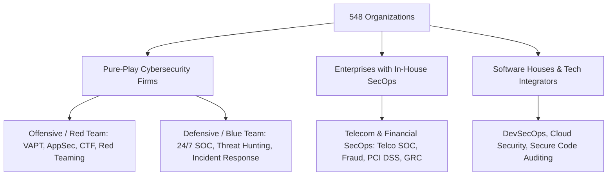

# Cybersecurity Companies & Job Directory (Pakistan)

[](cyber_security_companies_pakistan.csv)
[](cyber_security_companies_pakistan.csv)
[](cyber_security_companies_pakistan.csv)
[](LICENSE)
[](cyber_security_companies_pakistan.csv)

The most comprehensive, actionable, and rigorously scored directory of **548 cybersecurity firms, enterprise security operations (SecOps) departments, and tech companies** across Pakistan. 

Built specifically for cybersecurity professionals, ethical hackers, SOC analysts, GRC auditors, and university graduates seeking **jobs, internships, and direct recruitment pathways**.

---

## Table of Contents
- [Executive Overview](#executive-overview)
- [Dataset Architecture & Dictionary](#dataset-architecture--dictionary)
- [Career Specialization Matrix (Red vs. Blue Team)](#career-specialization-matrix-red-vs-blue-team)
- [Recruitment & Application Reality](#recruitment--application-reality)
- [Featured Top-Tier Cybersecurity Employers](#featured-top-tier-cybersecurity-employers)
- [How to Filter & Use This Dataset](#how-to-filter--use-this-dataset)
- [Sources & Accreditation](#sources--accreditation)
- [Contributing](#contributing)
- [License](#license)

---

## Executive Overview

Navigating the cybersecurity job landscape in Pakistan is notoriously fragmented. Job seekers often encounter dead job links, outdated lists, unverified email formats, or uncertainty regarding whether an IT company actually has an active offensive or defensive security unit.

This repository resolves that with:
- **548 Unique Companies:** Spanning Islamabad, Lahore, Karachi, Rawalpindi, Peshawar, Faisalabad, and Remote.
- **Scored Career Relevancy (1-10):** Independent Red Teaming (Offensive) and Blue Teaming (Defensive) ratings for every firm.
- **283 Verified Live Career Pages / Portals:** Authenticated via automated HTTP validation and navigation crawling.
- **111 Verified Direct HR / Executive Contacts:** Sourced from official Pakistan National CERT (PKCERT) audit empanelments, PTA registries, and verified hiring announcements.
- **Zero Hallucinated Contacts:** Explicit `Contact Verification Status` so applicants never blast emails into non-existent mailboxes.

---

## Dataset Architecture & Dictionary

The master data file is [`cyber_security_companies_pakistan.csv`](cyber_security_companies_pakistan.csv). It contains 18 structured columns:

| # | Field Name | Description | Example |
| :-: | :--- | :--- | :--- |
| **1** | `Company Name` | Official corporate or operating business name | `Ebryx (Pvt) Ltd` |
| **2** | `Website` | Canonical company URL | `https://www.ebryx.com/` |
| **3** | `Careers Page / Job Portal URL` | Verified URL to browse open positions & apply | `https://www.ebryx.com/careers` |
| **4** | `Careers Page Status` | Verification status of the hiring portal | `Verified Official Portal` / `No Dedicated Careers Page Found` |
| **5** | `Careers / HR Contact Email` | Direct recruitment, talent acquisition, or HR email | `jobs@ebryx.com` |
| **6** | `General Contact Email` | Corporate, executive, or management email | `syed.talal@ebryx.com` |
| **7** | `Contact Verification Status` | Authenticity classification of the email address | `Verified (Government Registry / Curated Contact)` |
| **8** | `Headquarters / Location` | Primary city or operating locations in Pakistan | `Lahore / Islamabad / Karachi` |
| **9** | `Country` | Operating country | `Pakistan` |
| **10** | `Company Category` | Industry classification of the organization | `Pure-Play Cyber Security Firm` |
| **11** | `Cyber Relevance Score (1-10)` | Overall score reflecting security focus (10 = pure-play) | `10` |
| **12** | `Red Teaming Relevance (1-10)` | Suitability for Offensive Security / Ethical Hacking | `10` |
| **13** | `Red Teaming Rating` | Categorical offensive tier (`High`, `Moderate`, `Low`) | `High` |
| **14** | `Blue Teaming Relevance (1-10)` | Suitability for Defensive SecOps, SOC, DFIR, GRC | `10` |
| **15** | `Blue Teaming Rating` | Categorical defensive tier (`High`, `Moderate`, `Low`) | `High` |
| **16** | `Primary Job Roles / Best Suited For` | Specific job titles recommended for this company | `MDR Analyst, VAPT Engineer, SecOps Lead` |
| **17** | `Core Services & Expertise` | Breakdown of security services, tech stack, and offerings | `24/7 Managed SOC, Penetration Testing, MDR` |
| **18** | `Source / Reference` | Citation of original registry, empanelment, or ingestion | `PKCERT Approved Auditor, GitHub, Clutch` |

---

## Career Specialization Matrix (Red vs. Blue Team)

Organizations in this directory are categorized to help candidates apply for roles matching their certifications and skill sets:



### Red Teaming (Offensive Security)
- **Relevant Roles:** Penetration Tester, Vulnerability Researcher, Web/API AppSec Specialist, Red Team Operator, Bug Bounty Hunter, Smart Contract Auditor.
- **Top Certifications Valued:** OSCP, eJPT, CEH Practical, Burp Suite Certified Practitioner, PNPT.
- **How to Filter:** Set `Red Teaming Rating` = `High` (Relevance Score: 8-10).

### Blue Teaming (Defensive Security)
- **Relevant Roles:** SOC Analyst (L1/L2/L3), Threat Intelligence Analyst, Incident Responder (DFIR), SIEM/SOAR Engineer, Security Architect, ISO 27001 / PCI QSA Auditor.
- **Top Certifications Valued:** BTL1, CompTIA Security+, CySA+, Certified Threat Intelligence Analyst (CTIA), CISSP, CISA.
- **How to Filter:** Set `Blue Teaming Rating` = `High` (Relevance Score: 8-10).

---

## Recruitment & Application Reality

Most applicants fail because they send blind cold emails to unmonitored generic addresses (`careers@...`) and receive mail delivery bounces. This dataset is engineered to prevent that:

### 1. The Portal vs. Cold Email Rule
- **If `Careers Page Status` = `Verified Live Career Page`:**  
  **Always submit through their portal link first.** Modern tech firms (e.g., Systems Limited, 10Pearls, Arbisoft, Netsol) use Applicant Tracking Systems (ATS) like Workable, Lever, or BambooHR and do not monitor cold emails.
- **If `Contact Verification Status` = `Verified (Government Registry / Curated Contact)`:**  
  **Safe for direct cold outreach.** These emails (`jobs@ebryx.com`, `jobs@tranchulas.com`, `aniqa.fareed@trilliuminfosec.com`, `kashif.hassan@riskassociates.com`) are genuine, verified inboxes.
- **If `Contact Verification Status` = `Pattern Fallback`:**  
  **Do NOT rely exclusively on email.** The address is an estimated convention (`careers@{domain}`); prioritize the web application form or contact page.

---

## Featured Top-Tier Cybersecurity Employers

Below is a curated sample of premier cybersecurity consulting and operations centers in Pakistan:

| Company | Careers Portal / URL | HR / Recruitment Email | Primary Security Focus |
| :--- | :--- | :--- | :--- |
| **[Ebryx](https://www.ebryx.com/)** | [ebryx.com/careers](https://www.ebryx.com/careers) | `jobs@ebryx.com` | MDR, 24/7 Managed SOC, Advanced VAPT, Security Engineering |
| **[Apprise Cyber](https://apprise-cyber.com/)** | [apprise-cyber.com/careers](https://apprise-cyber.com/careers-at-apprise-cyber/) | `careers@apprise-cyber.com` | Full-Spectrum Cyber, DFIR, Penetration Testing, GRC |
| **[Tranchulas](https://tranchulas.com/)** | [tranchulas.com/careers](https://tranchulas.com/careers/) | `jobs@tranchulas.com` | Offensive Security, Threat Simulation, Security Architecture |
| **[Trillium (TISS)](https://infosecurity.com.pk/)** | [trilliuminfosec.com/careers](https://trilliuminfosec.com/careers/) | `careers@trilliuminfosec.com` | Enterprise InfoSec, SOC Engineering, PKCERT Auditor |
| **[Risk Associates](https://riskassociates.com/)** | [riskassociates.com/careers](https://riskassociates.com/careers/) | `careers@riskassociates.com` | PCI QSA Audits, ISO 27001, GRC, Cloud Compliance |
| **[Rewterz](http://www.rewterz.com/)** | [pk.indeed.com/cmp/Rewterz](https://pk.indeed.com/cmp/Rewterz) | `careers@rewterz.com` | 24/7 Managed SOC, Threat Hunting, SIEM/EDR Defense |
| **[SecurityWall](https://securitywall.co/)** | [securitywall.co/careers](https://securitywall.co/careers) | `careers@securitywall.co` | Offensive VAPT, CTDISR Audits, DevSecOps Consulting |
| **[Dunicot](https://dunicot.com/)** | [dunicot.com/careers](https://dunicot.com/careers/) | `careers@dunicot.com` | Banking Security, Web/API Pentesting, SOC 2 / PCI Audits |
| **[CyMax Technologies](https://cymaxtech.com/)** | [cymaxtech.com/career](https://cymaxtech.com/career) | `careers@cymaxtech.com` | OSCP Pentesting, SBP Compliance, Red Teaming |
| **[RedSecLabs](https://redseclabs.com/)** | [redseclabs.com/careers](https://redseclabs.com/careers) | `careers@redseclabs.com` | Red Teaming, Vulnerability Management |
| **[Systems Limited](https://www.systemsltd.com/)** | [systemsltd.com/careers](https://www.systemsltd.com/careers) | `careers@systemsltd.com` | Enterprise SOC Analyst, Cloud Security, Threat Intel |
| **[10Pearls](https://10pearls.com/)** | [10pearls.com/careers](https://10pearls.com/careers/) | `careers@10pearls.com` | AppSec Engineer, DevSecOps Specialist, SecOps |
| **[Telenor Pakistan](https://www.telenor.com.pk/)** | [telenor.com.pk/careers](https://www.telenor.com.pk/careers/) | `careers@telenor.com.pk` | Telecom SecOps, Critical Infrastructure Defense |

---

## How to Filter & Use This Dataset

### In Microsoft Excel or Google Sheets:
1. Open [`cyber_security_companies_pakistan.csv`](cyber_security_companies_pakistan.csv).
2. Enable **Filter** (`Data` -> `Filter`).
3. **To find Offensive / Pentesting jobs:** Filter `Red Teaming Rating` = `High`.
4. **To find Defensive / SOC jobs:** Filter `Blue Teaming Rating` = `High`.
5. **To find verified career portals:** Filter `Careers Page Status` = `Verified Official Portal` or `Verified Live Career Page`.

### In Python / Pandas:
```python
import pandas as pd

df = pd.read_csv("cyber_security_companies_pakistan.csv")

# Filter for top pure-play cybersecurity firms hiring for Red Teaming in Islamabad or Lahore
red_team_jobs = df[
    (df["Red Teaming Rating"] == "High") &
    (df["Company Category"] == "Pure-Play Cyber Security Firm") &
    (df["Headquarters / Location"].str.contains("Islamabad|Lahore", na=False))
]

print(red_team_jobs[["Company Name", "Careers Page / Job Portal URL", "Careers / HR Contact Email"]])
```

---

## Sources & Accreditation

Data was compiled, cross-verified, and enriched through authoritative sources:
1. **Pakistan National CERT (PKCERT):** Approved Information Security Auditing Organizations.
2. **Pakistan Telecommunication Authority (PTA):** Cyber Security Audit Framework (CSAF) and CTDISR regulations.
3. **P@SHA (Pakistan Software Houses Association):** Accredited IT exporters and security vendors.
4. **StartupBlink:** Pakistan Cyber Security Ecosystem Index.
5. **TechBehemoths:** Verified Cybersecurity Service Providers in Islamabad, Lahore, and Karachi.
6. **Community Repositories:** [huzaifahere/cyber-security-companies-in-pakistan](https://github.com/huzaifahere/cyber-security-companies-in-pakistan).
7. **NexaSecTech:** Top Cyber Security Companies Directory.

---

## Contributing

Community contributions are welcome! If you know of a cybersecurity startup, corporate SecOps team, or updated HR contact email in Pakistan:

1. Fork this repository.
2. Update [`cyber_security_companies_pakistan.csv`](cyber_security_companies_pakistan.csv) with verified information.
3. Submit a Pull Request with a clear description and citation/source.

---

## License

This repository and dataset are distributed under the **MIT License**. Free for personal, commercial, and research use.
